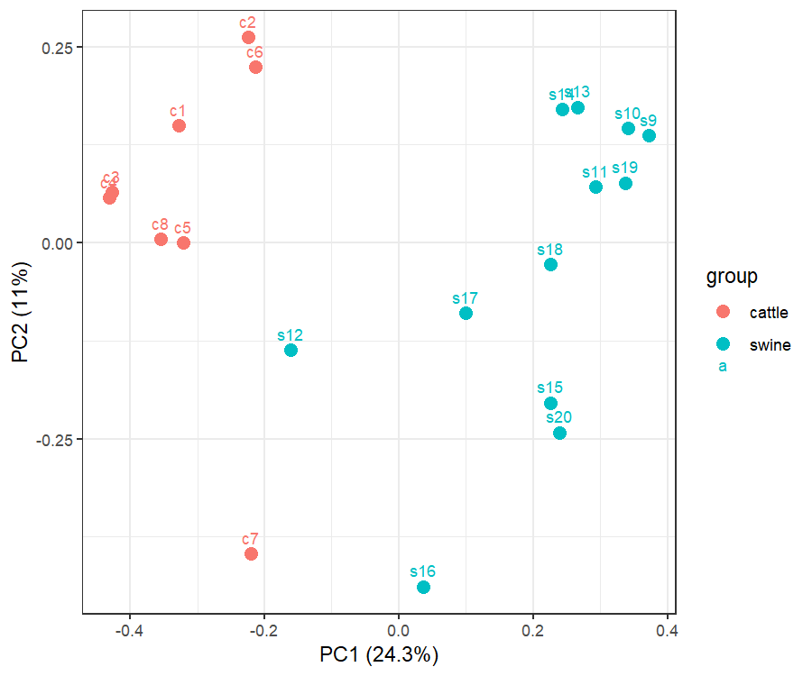
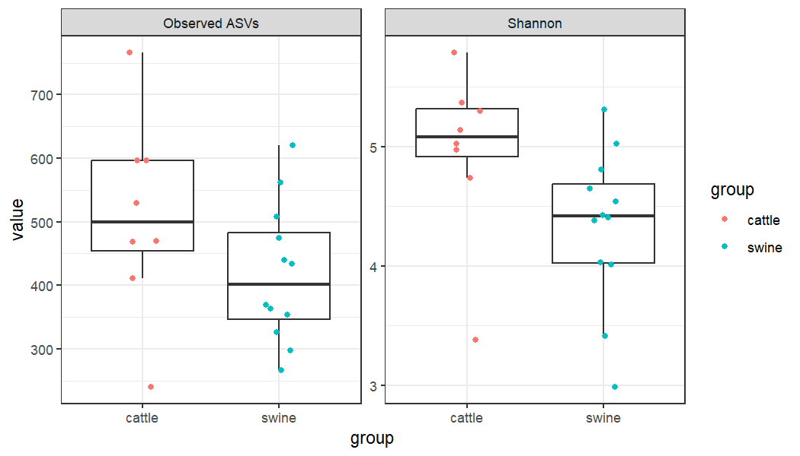
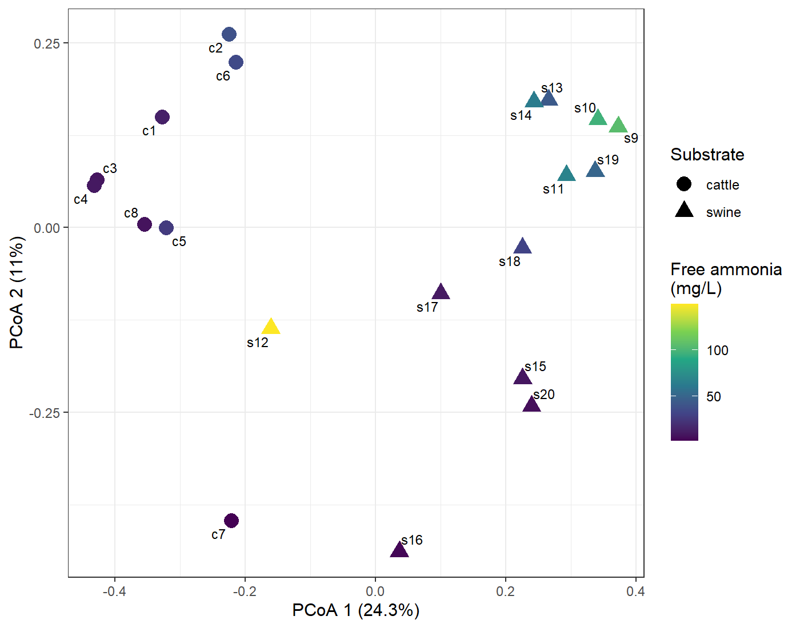
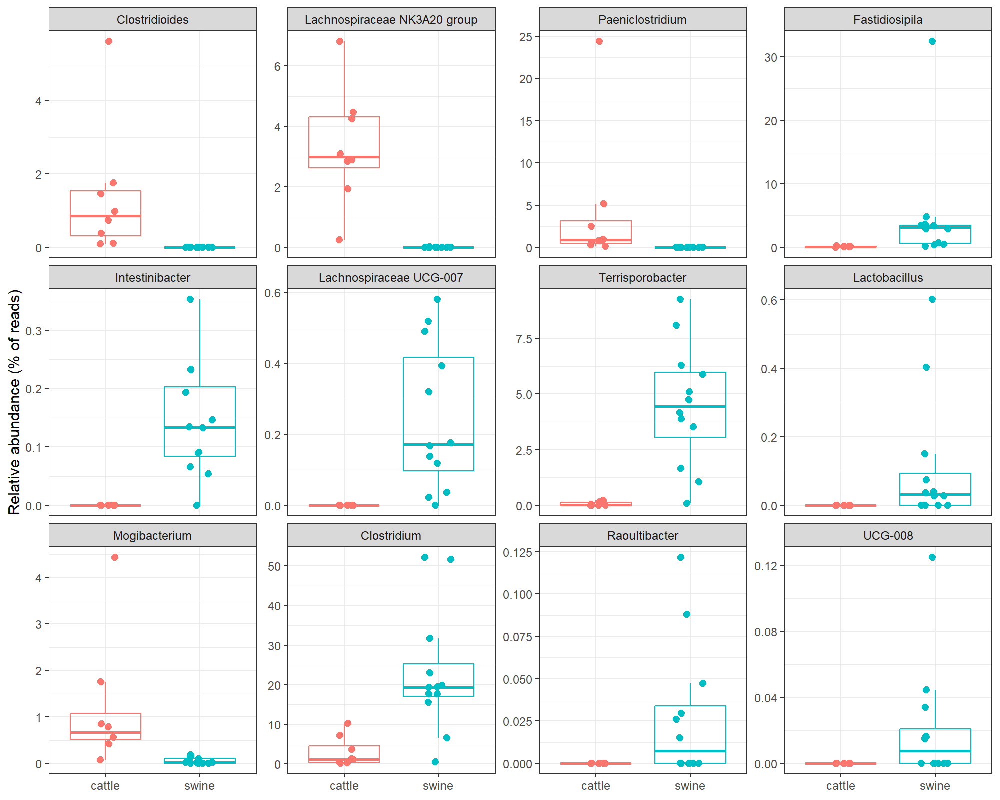

# Microbial community structure in cattle and swine manure biogas digesters: a 16S rRNA amplicon re-analysis of public data

**Repository:** `manure-digester-16s` | **Source data:** ENA project PRJEB6969 | **Languages:** R, bash

## Abstract

Anaerobic digestion of livestock manure depends on a diverse community of bacteria and archaea, yet the factors that structure this community in full-scale digesters are incompletely understood. We re-analysed public 16S rRNA gene amplicon reads from 20 full-scale biogas digesters (8 treating cattle manure, 12 treating swine manure; ENA PRJEB6969). Reads were processed into an amplicon sequence variant (ASV) table with DADA2 and classified against SILVA 138.2, and community diversity and composition were compared between substrates and in relation to free ammonia. Substrate explained 21% of the variation in Bray-Curtis dissimilarity (PERMANOVA, R2 = 0.21, p < 0.001), and the result was unchanged when two divergent samples were excluded. Free ammonia explained a further 8.6% of the variation after accounting for substrate (p = 0.0099), although substrate, ammonia, region and reactor design are confounded in this dataset. Cattle digesters had higher Shannon diversity (median 5.08 vs 4.42; p = 0.034, uncorrected for multiple testing). Of 190 genera tested, 20 differed between substrates at a false-discovery rate below 5%. Archaea were detected at low relative abundance (0.00-1.18% of reads per sample) and are described but not compared between groups. This is an exploratory re-analysis of a single published dataset and not an independent replication. All scripts and intermediate results are provided.

## Quick start

    git clone https://github.com/hopendeesor/manure-digester-16s.git
    cd manure-digester-16s

The workflow consists of 16 numbered scripts that are run from the repository root. Section 9 lists the requirements, the installation commands, the run order and the output expected from each step. One input file (supplementary Table S1 of the source publication) has to be downloaded manually.

## 1. Background

Anaerobic digestion converts organic matter into biogas through successive microbial steps (hydrolysis, fermentation, acetogenesis and methanogenesis) carried out by interacting bacteria and archaea. Livestock manure is a widely used feedstock, and digester stability depends on the composition of the microbial community. Ammonia, which accumulates when nitrogen-rich substrates are digested, is known to inhibit methanogens, particularly the acetoclastic genus Methanosaeta (Demirel and Scherer, 2008).

Amplicon sequencing of the 16S rRNA gene is a standard way to profile such communities. It yields relative abundances and taxonomic assignments, but no direct information on gene content or activity. Li et al. (2015) sequenced 16S amplicons from 20 full-scale digesters in China and reported that substrate type was the primary factor shaping bacterial community structure. The raw reads were deposited in the European Nucleotide Archive. Here, those reads are re-processed with an ASV-based workflow, sensitivity analyses and a screen for divergent or mislabelled samples are added, and every step is documented so that it can be re-run.

## 2. Objectives

1. Reconstruct an ASV table from the raw reads and verify each processing step.
2. Screen the samples for mislabelled or divergent samples before any statistical inference.
3. Compare alpha and beta diversity between cattle and swine digesters.
4. Test whether free ammonia is associated with community composition independently of substrate, and whether the conclusions depend on two divergent samples.
5. Identify genera that differ between substrates and describe the archaeal (methanogen) fraction.

## 3. Data

| Item | Description |
|---|---|
| Reads | ENA project PRJEB6969 (secondary study accession ERP006648), Chengdu Institute of Biology, Chinese Academy of Sciences |
| Source publication | Li et al. (2015), Frontiers in Microbiology 6:1337 |
| Samples | 20 sludge samples from full-scale digesters: 8 treating cattle manure (c1-c8) and 12 treating swine manure (s9-s20), from 10 provinces or districts of China |
| Sequencing | Illumina MiSeq, single-end amplicon reads of about 252-253 bp |
| Sequencing depth | 442,210 raw reads in total; 13,525-33,320 per sample |
| Digester metadata | Supplementary Table S1 of the source publication: province, reactor type, temperature, pH, COD, NH4+-N, free ammonia, phosphate, C:N (downloaded manually) |
| Reference database | SILVA 138.2 nr99 genus-level training set for DADA2 (Zenodo record 14169026); MD5 of the file used: 1764e2a36b4500ccb1c7d5261948a414 |

Notes on the data:

- The ENA project description refers to pyrosequencing, but the run record that was checked (ERR579095) states Illumina MiSeq, single-end. The run record was used.
- Raw reads are not stored in this repository (`data/raw/` is excluded by `.gitignore`). Script 02 downloads them and verifies each file against the ENA MD5 checksum.
- The dataset compares cattle and swine digesters. It contains no raw manure samples, so it cannot show what changes between manure and digester.

## 4. Methods

Scripts are numbered in the order in which they were run (Section 9.4).

### 4.1 Read processing

Run lists, read counts and checksums were retrieved from the ENA portal API, and each FASTQ file was verified against its MD5 checksum (scripts 01-02). Reads were truncated to 250 bp, and reads containing ambiguous bases or more than two expected errors were discarded, together with PhiX (DADA2 `filterAndTrim`: `truncLen = 250`, `maxN = 0`, `maxEE = 2`, `truncQ = 2`, `rm.phix = TRUE`; script 03). Reads shorter than 250 bp were discarded. The DADA2 error model was learned jointly from all samples, reads were denoised per sample, and chimeras were removed with the consensus method (script 04; single-threaded). No primer-removal step was applied, because the reads already appeared to begin at a common position (Section 5.1).

### 4.2 Taxonomic classification

ASVs were classified with the DADA2 naive Bayesian classifier (`assignTaxonomy`) against the SILVA 138.2 nr99 genus-level training set (scripts 05-06). Genus-level analyses use only reads whose ASV received a genus name.

### 4.3 Sample grouping and screening

Samples were assigned to cattle (c1-c8) or swine (s9-s20) from their names, and the assignment was checked against the substrate code in Table S1 (scripts 07 and 10). Before any inference, samples were screened using Bray-Curtis dissimilarities computed on relative abundances: a first principal coordinates analysis (PCoA), each sample's mean dissimilarity to all other samples, its nearest neighbour, the correlation of the first PCoA axis with sequencing depth, and the phylum and genus composition of samples that stood out (scripts 08-09).

### 4.4 Alpha diversity

Samples were rarefied without replacement to the smallest sample depth (11,181 reads; `rrarefy`, seed 1). Observed ASV richness and the Shannon index were calculated (script 11). Cattle and swine were compared with Wilcoxon rank-sum tests, and diversity was related to free ammonia, pH and NH4+-N with Spearman rank correlations.

### 4.5 Beta diversity

Bray-Curtis dissimilarities were calculated on relative abundances (not rarefied). Differences between substrates were tested with PERMANOVA (`adonis2`, 9,999 permutations, seed 1) for substrate alone, for free ammonia alone, and for each of the two after accounting for the other (marginal tests). Homogeneity of group dispersion was tested with `betadisper` and `permutest`. All tests were repeated after excluding the two most divergent samples, s12 and c7 (script 12). Ordinations were drawn with PCoA (`cmdscale`; script 13).

### 4.6 Differential abundance

ASV counts were summed to genus level, and genera present in at least 5 of the 20 samples were retained (190 genera). Counts were transformed with the centred log-ratio (CLR) using a pseudocount of 0.5. Each genus was tested between substrates with a Wilcoxon rank-sum test, and p-values were adjusted across the 190 genera with the Benjamini-Hochberg procedure (script 14).

### 4.7 Methanogen summary and literature annotation

The share of archaeal reads and of reads assigned to a hand-written list of 16 methanogen genera was calculated per sample (script 07). Functional roles of selected genera were annotated manually from the literature (`data/genus_roles.txt`, with sources in `data/role_sources.txt`) and joined to the abundance results (script 16). Genera for which no source was verified were left unannotated. These roles are taken from the literature and are not measured in this study.

### 4.8 Statistical conventions

Alpha-diversity and PERMANOVA p-values are not corrected for multiple testing, and only the genus-level analysis uses a false-discovery correction (q-values). With 9,999 permutations the smallest attainable p-value is 0.0001, which is reported as p < 0.001. Random seeds were fixed (seed 1) in scripts 11, 12 and 13.

## 5. Results

### 5.1 Sequence processing

Filtering retained 402,727 of 442,210 reads (91%), and every sample retained at least 12,293 reads. DADA2 inferred 4,981 ASVs, of which 4,945 remained after chimera removal. The final table contains 382,651 reads (86.5% of the raw reads), with per-sample depths between 11,181 (c1) and 30,397 (s17). Read lengths were almost uniform (98% were 252 or 253 bp), and 84% of the reads of one sample that was inspected (c1) began with the same four bases. This suggests that primer sequences had been removed before deposition. It was inferred from the reads and is not stated in the ENA record. Per-sample counts are in `results/03_filter_summary.tsv` and `results/04_track.tsv`.

### 5.2 Taxonomic composition

All 4,945 ASVs were classified at kingdom level (4,876 Bacteria and 69 Archaea), 4,890 at phylum level and 2,579 at genus level. Of all reads, 71% belong to ASVs with a genus name. Across samples, the mean relative abundance was highest for Bacillota (59.8%), followed by Bacteroidota (14.1%), Chloroflexota (6.7%) and Thermodesulfobacteriota (3.5%). The full classification is in `results/06_taxonomy.tsv`.

### 5.3 Screening for divergent and mislabelled samples

*Figure 1. First PCoA of Bray-Curtis dissimilarities (relative abundances), used for sample screening. PCoA 1 and 2 explain 24.3% and 11.0% of the variation.*

Two samples were clearly separated from all others: s12 (mean dissimilarity to the other samples 0.971) and c7 (0.957); the next highest value was 0.874. Their nearest neighbours were also distant (s12 to c6: 0.930; c7 to s16: 0.894), so they are divergent but do not resemble samples of the other group, which argues against a simple mislabelling. For the remaining 18 samples the nearest neighbour belonged to the same substrate group. The group labels derived from sample names agreed with the substrate codes in Table S1 for all 20 samples.

Sample s12 was 90.9% Bacillota (the genus Fastidiosipila alone accounted for 32.5% of its reads) and had the highest free ammonia in the dataset (149.2 mg/L). Sample c7 was 25.4% Chloroflexota, had the lowest pH (6.50) and the lowest free ammonia (1.34 mg/L), and was the only sample from Guangxi. Both were therefore retained as probable real extremes, and the main tests were repeated without them (Section 5.5). Samples s13 and s14 (both from Shanghai) were unusually similar (dissimilarity 0.134; Bacillota 54.9% and 54.0%; Bacteroidota 26.3% and 26.7%), although their pH and free ammonia differ. This similarity was not explained. The first PCoA axis was only weakly correlated with sequencing depth (r = 0.22). Details are in `results/08_outlier_check.tsv` and `results/09_inspect_samples.txt`.

### 5.4 Alpha diversity

*Figure 2. Observed ASVs and Shannon diversity of cattle and swine digesters after rarefaction to 11,181 reads per sample.*

| | Cattle (median) | Swine (median) | Wilcoxon p |
|---|---|---|---|
| Observed ASVs | 500.0 | 401.5 | 0.177 |
| Shannon index | 5.08 | 4.42 | 0.034 |

Across all 20 samples, both measures were negatively correlated with free ammonia, pH and NH4+-N (Spearman):

| | Free ammonia | pH | NH4+-N |
|---|---|---|---|
| Observed ASVs | rho = -0.65, p = 0.0019 | rho = -0.55, p = 0.0126 | rho = -0.71, p = 0.0005 |
| Shannon index | rho = -0.72, p = 0.0004 | rho = -0.66, p = 0.0016 | rho = -0.70, p = 0.0005 |

Eight tests were performed and the p-values are uncorrected. At a Bonferroni threshold of 0.05 / 8 = 0.00625, five of the six correlations remain significant; the Shannon difference between substrates and the correlation of observed ASVs with pH do not. The three chemical variables are not independent of each other, and all differ strongly between substrates, so the correlations partly restate the difference between cattle and swine. Values are in `results/11_alpha.tsv`.

### 5.5 Beta diversity

*Figure 3. PCoA of Bray-Curtis dissimilarities. Shape indicates substrate and colour indicates free ammonia (linear scale, stretched by s12). The two axes together explain 35.3% of the variation, so distances in the plot are approximate.*

| Test (PERMANOVA) | All 20 samples | Without s12 and c7 (n = 18) |
|---|---|---|
| Substrate alone | R2 = 0.211, F = 4.82, p < 0.001 | R2 = 0.269, F = 5.88, p < 0.001 |
| Free ammonia alone | R2 = 0.106, p = 0.0092 | R2 = 0.157, p = 0.0029 |
| Substrate, given free ammonia | R2 = 0.191, p < 0.001 | R2 = 0.217, p < 0.001 |
| Free ammonia, given substrate | R2 = 0.086, p = 0.0099 | R2 = 0.105, p = 0.0082 |
| Dispersion (mean distance to group centre, cattle / swine) | 0.533 / 0.483, p = 0.375 | 0.50 / 0.45, p = 0.144 |

Substrate explained about one fifth of the variation, and the effect did not depend on the two divergent samples. Group dispersions did not differ significantly, although with 8 and 12 samples this test has little power. Free ammonia explained a smaller share that remained after accounting for substrate. Because the two variables are strongly related, these estimates may be unstable. Full output is in `results/12_beta.txt`.

### 5.6 Differential abundance

*Figure 4. Relative abundance of the 12 genera with the smallest p-values in each group. Note the different y-axis in each panel.*

Of 190 genera tested, 20 had q < 0.05 and 34 had q < 0.10. The largest differences in mean share of reads were:

| Genus | Cattle | Swine | q |
|---|---|---|---|
| Clostridium | 3.00% | 22.93% | 0.028 |
| Fastidiosipila | 0.12% | 4.88% | 0.011 |
| Terrisporobacter | 0.07% | 4.48% | 0.012 |
| Paeniclostridium | 4.35% | 0 | 0.011 |
| Lachnospiraceae NK3A20 group | 3.32% | 0.001% | 0.011 |
| Clostridioides | 1.39% | 0 | 0.011 |
| Mogibacterium | 1.18% | 0.06% | 0.017 |

Several of these are presence-versus-absence patterns close to the detection limit, and some rest on a few samples: one cattle sample carries most of the Paeniclostridium signal, and s12 carries most of the Fastidiosipila signal in swine. Differences in means should therefore not be read as consistent differences between all digesters. The full table is in `results/14_diffabund.tsv`, with the console output in `results/14_diffabund.txt`.

### 5.7 Archaea and methanogens

Of the 69 archaeal ASVs, 41 were assigned to genera in the hand-written methanogen list. Archaeal reads made up 0.00-1.18% of each sample (highest in s15) and methanogen-genus reads 0.00-1.04%. Sample s10 had no archaeal reads at the reported precision. Cattle (0.09-0.70% methanogen reads) and swine (0.00-1.04%) overlapped completely, and the reads involved were few (from a handful to a few hundred per sample). Methanothrix was the most widespread methanogen (16 of 20 samples; 0.19% of reads in cattle and 0.15% in swine, q = 0.42); Methanosarcina occurred in 5 samples, and Methanobrevibacter and Methanobacterium in 6 each. No difference between substrates was detected, and the data have little power to detect one. Per-sample values are in `results/07_archaea_summary.tsv`.

### 5.8 Literature-based annotation

`results/16_functional_table.md` lists 23 genera (the 12 strongest differential genera plus selected methanogens, syntrophs and fibre degraders) with the abundances from this study next to the roles reported in the literature. Six of the twelve strongest genera (Clostridioides, Paeniclostridium, Intestinibacter, Lachnospiraceae UCG-007, Raoultibacter and UCG-008) have no annotated role because no source was verified. Several annotated genera (Lachnospiraceae NK3A20 group, Mogibacterium, and Methanobrevibacter) are reported in the literature mainly from ruminant guts, and Terrisporobacter has been isolated from bovine faeces.

## 6. Discussion

Substrate was the strongest factor associated with community composition in these 20 digesters. This agrees qualitatively with the conclusion of the source publication that substrate type is the primary factor shaping community structure, with higher bacterial diversity in cattle manure digesters and predominance of Clostridium sensu stricto in swine manure digesters (as summarised in the ENA project description). The present analysis used the same reads, a different pipeline (ASVs instead of OTUs), a different reference database and additional sensitivity checks. Agreement between the analyses therefore indicates that the finding is robust to these processing choices, not that it generalises to other digesters.

Free ammonia showed an association with community composition that remained after accounting for substrate, but its estimated effect was modest and cannot be separated from region, reactor type, temperature and C:N in a dataset of this size. The swine digesters had much higher free ammonia, and the ranges of C:N did not overlap between substrates (swine at most 2.27, cattle at least 2.56). The most extreme sample, s12, combined the highest free ammonia with a community dominated by Bacillota, which is consistent with the report of the source publication that free ammonia was positively associated with Firmicutes. This is one sample, and it does not establish a causal relationship.

Several of the genera that distinguish cattle from swine digesters are reported in the literature mainly from animal guts or faeces. Part of the substrate effect may therefore reflect gut-derived taxa carried in with the manure, in addition to selection within the digester. 16S rRNA data cannot show which of these organisms are active, and a taxon present in the digester may be a passenger.

Methanogens were detected, but at low relative abundance and in few reads per sample. This may reflect biology, the coverage of the primers for archaea, or both. The data support a description of which methanogen genera were detected and no inference about methanogenic pathways or about differences between substrates.

## 7. Limitations

- **Sample size and design.** 20 digesters (8 vs 12) from a single study, sequenced once at one time point, with no replication within digesters. The data are observational.
- **Confounding.** Substrate differs together with province, reactor type (2 upflow solid reactors and 18 stirred-tank reactors), temperature (25-36.5 degrees C), free ammonia and C:N. These effects cannot be separated here, so the results describe differences between these digesters and not effects of substrate. Digesters from the same province may resemble each other for unrelated reasons, which would make the permutation p-values too optimistic. Free ammonia is calculated from total ammonia, pH and temperature (as described in the source publication), so the chemical variables are not independent.
- **No performance data.** Biogas production is missing for 6 of 20 digesters and was not analysed. The study does not relate community composition to biogas yield.
- **Compositional data.** Relative abundances only; no absolute abundances. CLR results depend slightly on the pseudocount (0.5), and presence-versus-absence differences near the detection limit may reflect sequencing depth.
- **Multiple testing.** Alpha-diversity and PERMANOVA p-values are uncorrected. Standard compositional methods such as ANCOM-BC or ALDEx2 were not run.
- **Archaeal coverage.** Only 69 ASVs were archaeal, at 0-1.2% of reads per sample, so methanogen results are descriptive.
- **Taxonomy.** SILVA 138.2 names are used. The source publication used a different classifier and OTUs, so genus names and richness values (observed ASVs; no singletons are available from DADA2) cannot be compared directly. A SILVA "Clostridium" is not necessarily the same group as "Clostridium sensu stricto". Only 71% of reads carry a genus name.
- **Rarefaction** was used for alpha diversity only. Beta diversity and differential abundance use relative abundances or CLR values.
- **Divergent samples** (s12, c7) were retained. A sensitivity analysis was done for PERMANOVA only, not for alpha diversity or differential abundance, and the similarity of s13 and s14 was not explained.
- **Unchecked steps.** The DADA2 error model was not inspected (`plotErrors` was not run). That the primers were removed before deposition is inferred from the read starts, and the sequenced region is as described in the source publication and was not verified independently.
- **Literature annotation.** Roles come from cultured strains or other environments, rest partly on abstracts and excerpts, and some citations in `data/role_sources.txt` are incomplete.
- **Reproducibility.** The scripts were run in the stated order on one Windows machine and have not been re-run from a clean clone. One input (Table S1) must be downloaded manually.

## 8. Possible extensions

- Add a compositional differential-abundance method (ANCOM-BC or ALDEx2) and compare its results with the CLR and Wilcoxon analysis.
- Repeat the screening and the sensitivity analysis for alpha diversity and for differential abundance.
- Analyse a dataset that contains raw manure and digester samples from the same farms, to separate gut-derived taxa from taxa selected in the digester.
- Use a method that targets methanogens directly (for example mcrA amplicons) or shotgun metagenomes, because 16S coverage of archaea is limited here.

## 9. Reproducing the analysis

### 9.1 Requirements

- **Operating system:** developed on Windows 11 using Git Bash. The scripts should also run on Linux or macOS with bash, `curl` and `md5sum`, but this was not tested.
- **Git**, **bash** with `curl` and `md5sum` (all included in Git Bash), and **R** (4.6.1 was used).
- **Internet access** to ENA, Zenodo and the R package repositories.
- **Hardware:** all steps ran on a laptop with 4 cores and 7 GB of RAM. The taxonomic classification (script 06) completed with about 2.9 GB of free memory, so close other programs before running it. Run times were not recorded.
- **Disk space:** the SILVA file is 140 MB, and the raw and filtered reads are of the same order. Exact totals were not measured.

### 9.2 Installing the R packages

    Rscript -e 'install.packages(c("BiocManager", "vegan", "ggplot2", "ggrepel", "readxl"), repos = "https://cloud.r-project.org")'
    Rscript -e 'BiocManager::install("dada2", ask = FALSE, update = FALSE)'

Check the installation. The versions used were dada2 1.40.0, vegan 2.7.6, ggplot2 4.0.3, ggrepel 0.9.8 and readxl 1.6.0:

    Rscript -e 'for (p in c("dada2","vegan","ggplot2","ggrepel","readxl")) cat(p, as.character(packageVersion(p)), "\n")'

### 9.3 Getting the code

    git clone https://github.com/hopendeesor/manure-digester-16s.git
    cd manure-digester-16s

All commands below are run from this folder, because all paths are relative to it.

### 9.4 Running the workflow

    bash scripts/01_get_runlist.sh
    bash scripts/02_download_reads.sh
    Rscript scripts/03_filter.R
    Rscript scripts/04_dada2.R
    bash scripts/05_get_silva.sh
    Rscript scripts/06_taxonomy.R
    Rscript scripts/07_prepare.R
    Rscript scripts/08_outlier_check.R
    Rscript scripts/09_inspect_samples.R > results/09_inspect_samples.txt

Before script 10, download `DataSheet1.xlsx` (the supplementary material of the source publication, PMC4663275) in a web browser and save it as `data/raw/meta/DataSheet1.xlsx`. A script cannot download it, because the site blocks automated requests. Then continue:

    Rscript scripts/10_read_metadata.R
    Rscript scripts/11_alpha.R
    Rscript scripts/12_beta.R 2>&1 | tee results/12_beta.txt
    Rscript scripts/13_pcoa_figure.R
    Rscript scripts/14_diffabund.R 2>&1 | tee results/14_diffabund.txt
    Rscript scripts/15_diffabund_figure.R
    Rscript scripts/16_functional_table.R

Re-running a script overwrites its outputs. Close any image viewer before re-running a script that saves a figure.

### 9.5 Expected output

The console output below was obtained in the original run, and a correct re-run should reproduce it.

| Script | Purpose | Main outputs | Expected console output or check |
|---|---|---|---|
| 01_get_runlist.sh | List the 20 runs from ENA | data/processed/runlist.tsv | `wc -l data/processed/runlist.tsv` prints 21 |
| 02_download_reads.sh | Download FASTQ files and verify checksums | data/raw/*.fastq.gz | 20 lines starting with `ok`; on the first run each is preceded by `FAILED open or read`, which is the checksum pre-check on a file that does not exist yet and not an error. A second run prints only `ok` lines |
| 03_filter.R | Quality filtering | data/processed/filtered/, results/03_filter_summary.tsv | A table of 20 samples; 442,210 reads in and 402,727 out in total |
| 04_dada2.R | Error model, denoising, chimera removal | data/processed/seqtab_nochim.rds, results/04_track.tsv | `ASVs before chimera removal: 4981` and `ASVs after chimera removal: 4945` |
| 05_get_silva.sh | Download the SILVA training set | data/raw/ref/ | MD5 `1764e2a36b4500ccb1c7d5261948a414` and a size of 139996892 bytes |
| 06_taxonomy.R | Taxonomic classification | data/processed/taxa.rds, results/06_taxonomy.tsv | `ASVs: 4945`, `With phylum: 4890`, `With genus: 2579`; kingdoms: 69 Archaea, 4876 Bacteria |
| 07_prepare.R | Groups and archaea summary | data/processed/metadata.tsv, results/07_archaea_summary.tsv | `methanogen ASVs: 41` |
| 08_outlier_check.R | Sample screening and first PCoA | results/08_outlier_check.tsv, figures/08_pcoa_first_look.png | s12 (0.971) and c7 (0.957) at the top of the table; `PC% explained: 24.3 11`; `cor(PC1, reads): 0.22` |
| 09_inspect_samples.R | Composition of selected samples | results/09_inspect_samples.txt | Phylum and genus profiles of s12, c7, s13, s14 and the mean of all samples |
| 10_read_metadata.R | Read supplementary Table S1 | data/processed/digester_metadata.tsv | Cross-table with 8 cattle in C and 12 swine in S and zeros elsewhere; 3 missing values for `srt_day` and 6 for `biogas` |
| 11_alpha.R | Alpha diversity | results/11_alpha.tsv, figures/11_alpha_by_group.png | `Rarefied to 11181 reads per sample`; a vegan warning about singletons is expected |
| 12_beta.R | PERMANOVA and dispersion tests | results/12_beta.txt | `Group alone: R2=0.211 p=1e-04 F = 4.82` for all samples |
| 13_pcoa_figure.R | PCoA figure | figures/13_pcoa_group_fa.png | `PCoA 1 and 2 explain 24.3 11 percent` |
| 14_diffabund.R | Differential abundance | results/14_diffabund.tsv, results/14_diffabund.txt | `Reads with a genus name: 71 %`, `Named genera in >= 5 samples: 190`, `Genera with q < 0.05: 20` |
| 15_diffabund_figure.R | Figure of the top genera | figures/15_top_genera.png | `Plotted 12 genera` |
| 16_functional_table.R | Literature roles joined to abundances | results/16_functional_table.tsv and .md | `Genera in table: 23` and `No role annotated: 6` |

### 9.6 Troubleshooting

- **`Rscript: command not found`.** Add the `bin` folder of your R installation to the PATH, or open the terminal from RStudio.
- **`DataSheet1.xlsx` is only about 1.8 KB.** The download returned a web page instead of the spreadsheet. Download it in a browser. A valid file is about 60 KB and starts with the letters `PK`; check with `head -c 2 data/raw/meta/DataSheet1.xlsx`.
- **`unable to start png() device` when saving a figure.** The existing figure is open in an image viewer. Close it and re-run.
- **Script 06 stops with an error about allocating memory.** Close other programs and re-run.
- **A download in script 02 is interrupted.** Re-run the script; files that are already verified are skipped.
- **Warning that LF will be replaced by CRLF.** This is a harmless Git message on Windows.

## 10. Repository structure

    data/
      raw/               raw reads, SILVA file and Table S1 (excluded from Git)
      processed/         run list, ASV table, taxonomy and metadata (small files are tracked)
      genus_roles.txt    literature roles used for the functional table
      role_sources.txt   sources for those roles
    scripts/             scripts 01 to 16, numbered in order of use
    results/             tables and console output
    figures/             PNG figures

## 11. Data and code availability

Reads: ENA project PRJEB6969. Reference database: Zenodo record 14169026. Digester metadata: supplementary Table S1 of Li et al. (2015). Scripts, derived tables and figures are in this repository. Please cite the source publication (Li et al., 2015) if you use these data.

## 12. References

- Callahan BJ, McMurdie PJ, Rosen MJ, Han AW, Johnson AJA, Holmes SP (2016). DADA2: high-resolution sample inference from Illumina amplicon data. Nature Methods 13:581-583.
- Demirel B, Scherer P (2008). The roles of acetotrophic and hydrogenotrophic methanogens during anaerobic conversion of biomass to methane: a review. (Journal details to be completed; see `data/role_sources.txt`.)
- Li J, et al. (2015). Substrate type and free ammonia determine bacterial community structure in full-scale mesophilic anaerobic digesters treating cattle or swine manure. Frontiers in Microbiology 6:1337. doi:10.3389/fmicb.2015.01337
- SILVA 138.2 training set formatted for DADA2. Zenodo record 14169026.
- Further sources for the functional annotation: `data/role_sources.txt`.
